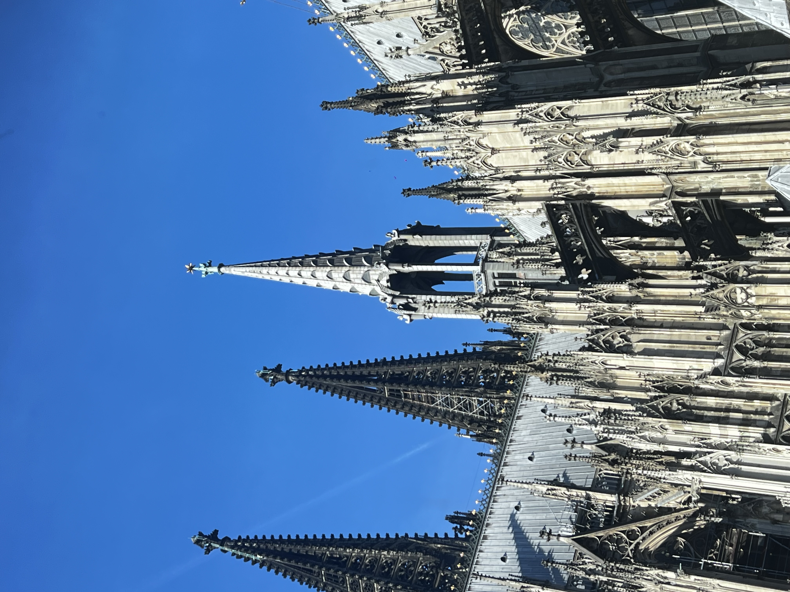
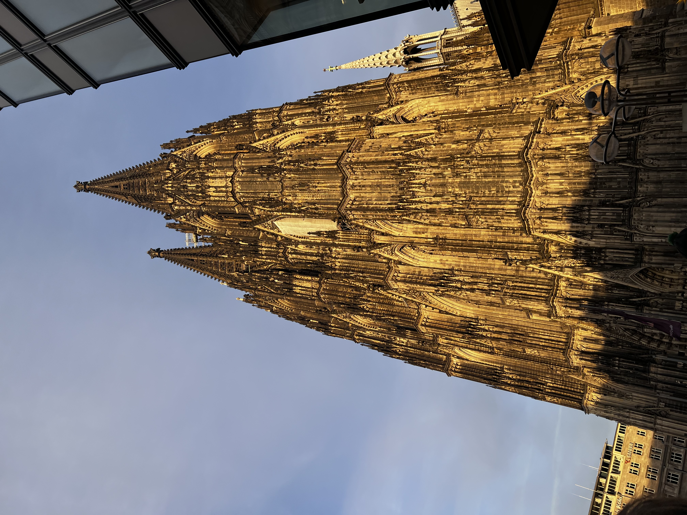
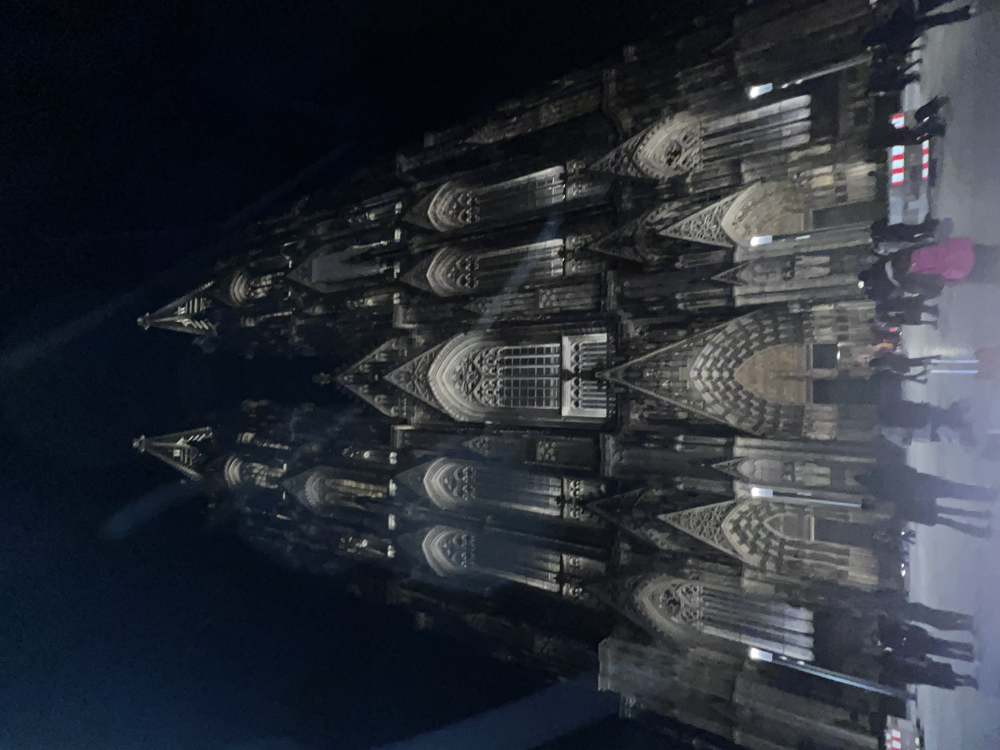
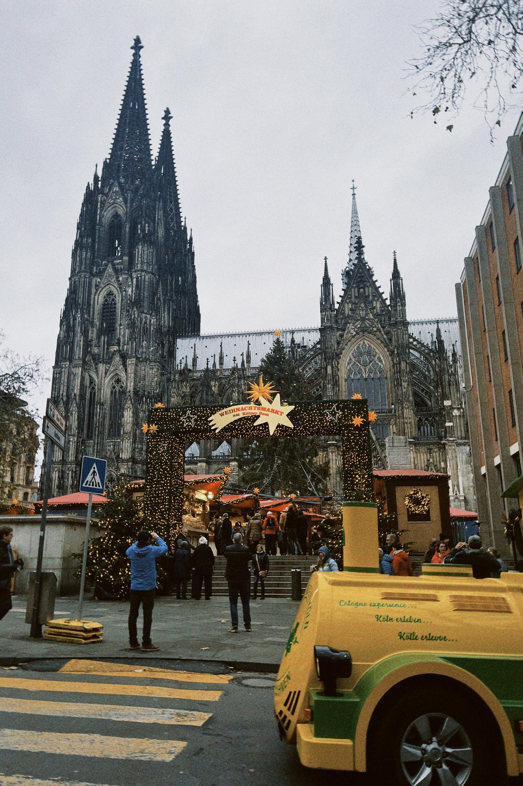
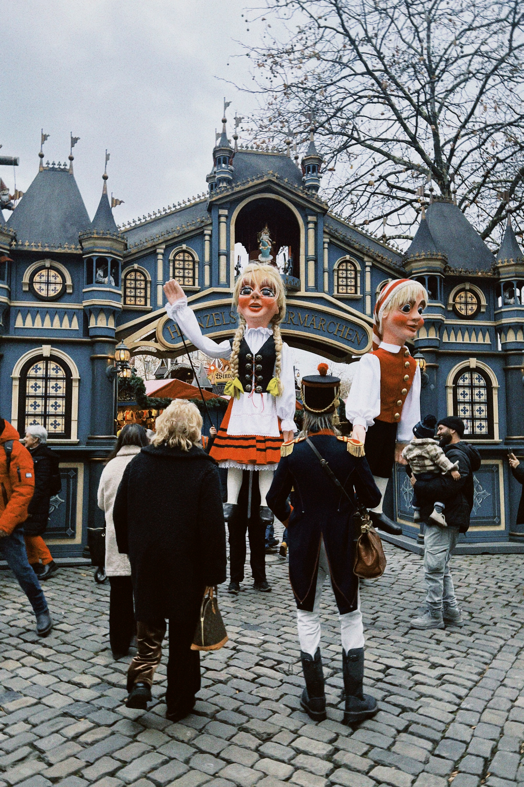
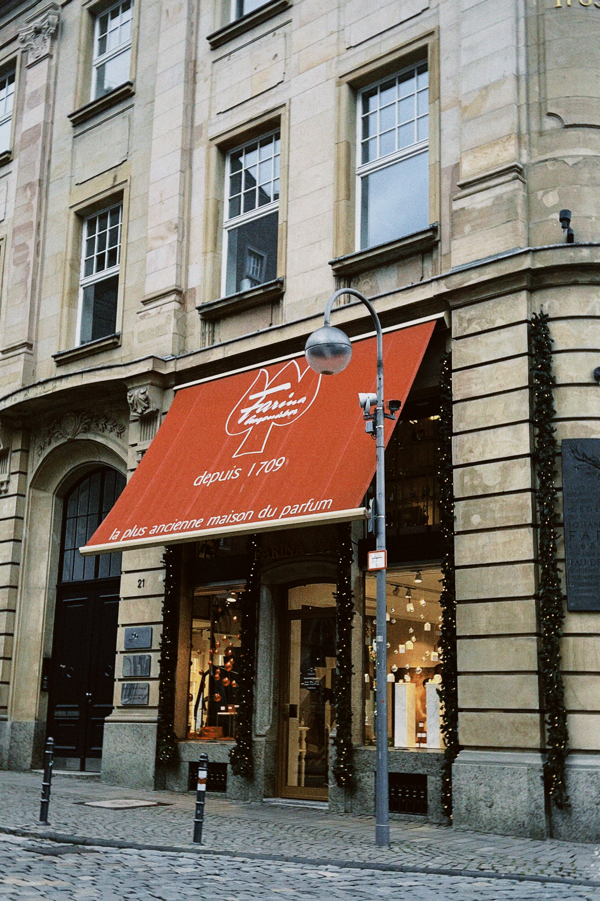
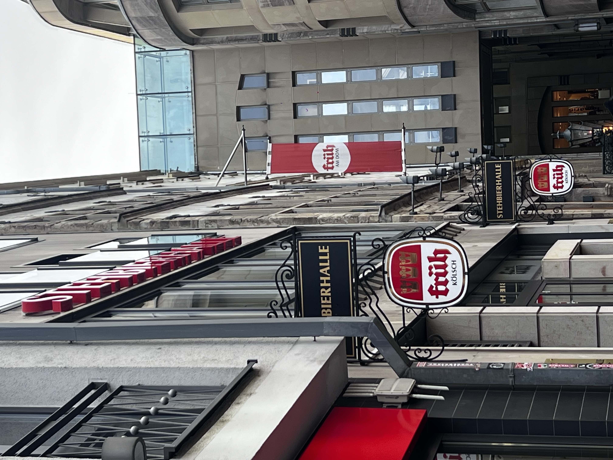
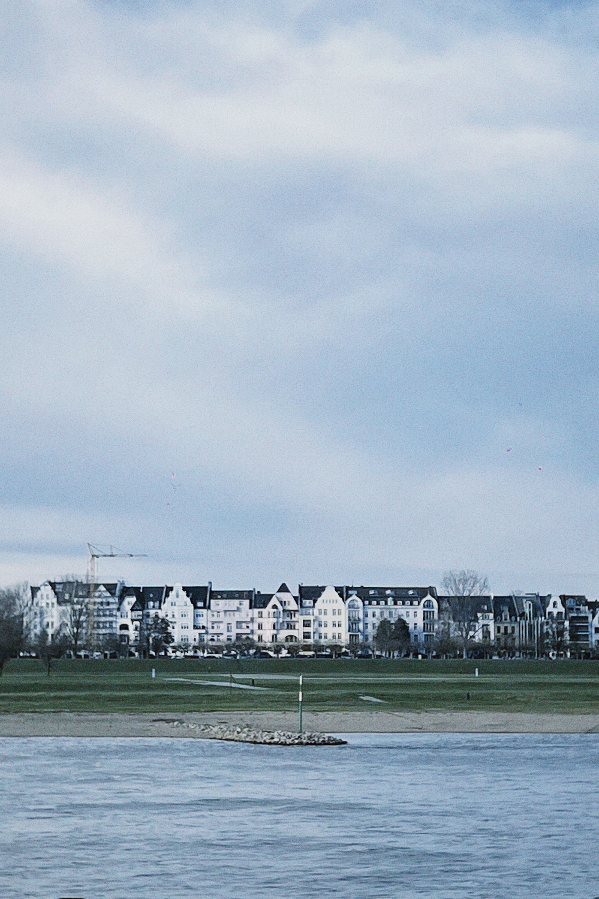
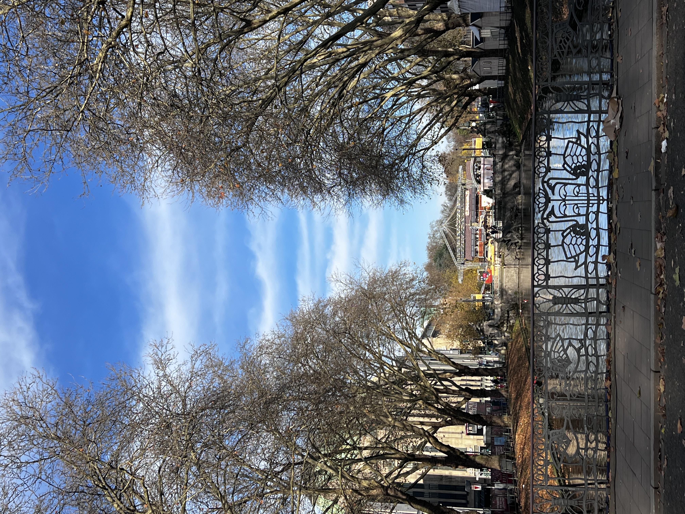

 
<a href="#spots">景點</a> · <a href="#food">食物</a> · <a href="#snaps">隨手拍</a>

景點 {#spots}

德國的聖誕市集非常有名，剛好有空，就和交換期間認識的朋友們一起去了科隆！

<b>Day 1</b>科隆 · 大教堂與聖誕市集

第一次看到科隆大教堂真的有被震撼到，是一座非常壯觀的哥德式教堂。教堂前面就有聖誕市集，其實在城市的其他區域也有許多大大小小的市集，每個地方都有不同的氛圍。

第一天吃了 Döner，晚上就開始逛聖誕市集、喝熱可可！而且每一年、每個地方的聖誕市集杯子都長得不一樣喔，所以有些人會特別收集各地的杯子，覺得很有紀念價值。

<b>Day 2</b>科隆 · 路德維希博物館與百年啤酒館

第二天去了路德維希博物館（Museum Ludwig），裡面收藏了許多畢卡索的作品。晚餐則去了一間很有名的百年啤酒館，當然不能錯過德式豬腳和啤酒！

<b>Day 3</b>杜塞道夫 · 初雪與萊茵河

第三天去了距離科隆大約一小時車程的杜塞道夫（Düsseldorf）。雖然一開始天氣很冷，但也在這裡看到了歐洲的初雪！

相較於科隆，杜塞道夫的知名度可能沒有那麼高，但我自己反而更喜歡這座可愛的城市。萊茵河畔真的很漂亮，聽說這裡也是一座充滿日式文化的城市。不過，我們去的那天剛好遇上德國亡靈節，所以聖誕市集都還沒開，只好改去喝當地特色的 Altbier（傳統上層發酵啤酒）。

也去了杜塞道夫很有名的國王大道（Königsallee），街道很漂亮，也很適合散步。雖然這次沒能逛到聖誕市集有點可惜，但萊茵河畔的風景很漂亮，還遇上歐洲的初雪，也算是很特別的旅行回憶！

  

<figure><figcaption>白天的大教堂</figcaption></figure>
<figure><figcaption>另一種角度的大教堂</figcaption></figure>
<figure><figcaption>晚上的大教堂</figcaption></figure>
<figure><figcaption>科隆大教堂的彩色玻璃</figcaption></figure>

<figure><figcaption>大教堂前的聖誕市集</figcaption></figure>
<figure><figcaption>聖誕市集裡有巨大的人偶</figcaption></figure>
<figure><figcaption>Farina，世界第一瓶古龍水就誕生在這家店</figcaption></figure>
<figure><figcaption>百年啤酒廠，啤酒好喝！還買了啤酒杯回家</figcaption></figure>
<figure><figcaption>漂亮的萊茵河畔</figcaption></figure>
<figure><figcaption>杜塞道夫的國王大道</figcaption></figure>

食物 {#food}

  

隨手拍 {#snaps}

